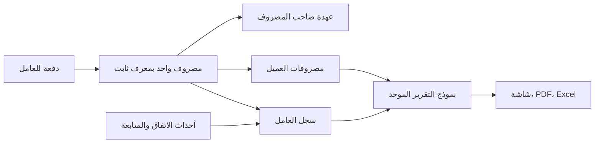

# خطة تطوير SAAS-Build وتحسين التصميم وتجربة الاستخدام

**التاريخ:** 24 أكتوبر 2026، توقيت طرابلس.
**النسخة المفحوصة:** `main`، الالتزام `2726e7318d39bded6a91e4a382935063751cecdf`.
**الحالة:** خطة مرجعية كُتبت قبل التنفيذ؛ نُفذت الأولويات الأساسية في [تقرير التنفيذ](IMPLEMENTATION-2026-10-24.md)، مع فصل الأفكار التوسعية عن الميزات المنجزة.
**النطاق:** ملف العميل، العمال وسجل كل عامل، التقرير الشامل، المصروف السريع والكميات، ثم المزايا الداعمة وجودة المشروع. فُسرت كلمة «الكمبيات» في الطلب على أنها **الكميات**.
**قرار المستخدم:** الاكتفاء بـFirestore والفهارس؛ لا تعتمد الخطة الأساسية على Storage أو Blaze أو Cloud Functions.

## 1. النتيجة التي نريد الوصول إليها

يرى صاحب الشركة فورًا: ما الاتفاق مع كل عامل، ماذا دُفع له، لماذا، وماذا تبقى. يسجل موظف الموقع مصروفًا بيد واحدة، باختيار عميل وفئة واضحين، إما بمبلغ مباشر أو كمية وسعر وحدة. يخرج المحاسب تقريرًا يطابق الشاشة ويعرض سجل كل عامل، مع احتساب حركة المال مرة واحدة.

التطوير المطلوب يجمع تحسين المظهر وسهولة الاستخدام مع موثوقية الحسابات. سنطور النظام الموجود، ونستخدم مكوناته وحساباته الصحيحة، ونصلح الأجزاء غير المكتملة قبل توسيع نطاق العمل.

### أهداف قابلة للقياس

| المجال | هدف القبول المقترح |
|---|---|
| مصروف معتاد | وسيط إتمام لا يتجاوز 10 ثوانٍ في تجربة مستخدم محددة، بعد تحميل التطبيق، لعميل وفئة مستخدمين مؤخرًا؛ يُقاس قبل التطوير وبعده |
| وضوح النموذج | العميل والفئة وطريقة حساب المبلغ وزر الحفظ متاحة دون تمرير أولي على 390×844 عند إغلاق لوحة مفاتيح الهاتف |
| حفظ المال | النقر المتكرر وإعادة المحاولة بعد بطء الشبكة ينتجان مستند مصروف واحدًا للعملية نفسها |
| تطابق الأرقام | فرق 0.000 د.ل بين سجل العامل والملخص والتقرير لنطاق البيانات نفسه |
| الاستحقاقات | مستحقات عامل لا تختفي بسبب زيادة مدفوعة لعامل آخر |
| المدخلات | لا تضيع المسودة بسبب فشل الحفظ أو الرجوع أو تحديث التطبيق |
| الوصولية | لا يخرج التركيز من النافذة النشطة، مع اختبار لوحة المفاتيح وقارئ الشاشة |
| التسليم | بناء ناجح على Windows وLinux، واختبارات الحسابات والقواعد والمسارات الأساسية ناجحة |

الأزمنة والأداء هنا أهداف مستقبلية، وليست نتائج قياس مكتملة للنسخة الحالية.

## 2. ما فُحص وما ثبت بالفعل

- قُرئت وثائق `PRODUCT.md` و`DESIGN.md` و`ACCESS.md`، ومسارات العمال والمصروف السريع والتقارير والحسابات وخدمات Firestore.
- فُحصت النسخة المنشورة من [التطبيق](https://saas-build-theta.vercel.app/) في جلسة موجودة، على سطح المكتب وقياس هاتف 390×844: المصروف السريع، ملف عميل، حالة العمال الفارغة ونموذج إضافة عامل. لم تُحفظ أو تُحذف بيانات.
- ثبت مباشرة أن `Shift+Tab` من بداية نموذج العامل يصل إلى زر «إضافة أول عامل» في النافذة الخلفية.
- بيانات العامل المعبأة وسجله الطويل لم تُختبر بصريًا في هذا الفحص؛ استنتاجات تلك الحالات مستندة إلى المصدر، وتحتاج بيانات تجريبية معزولة أثناء التنفيذ.
- في الجلسة نفسها: نجح lint دون تحذيرات، ونجحت اختبارات القواعد 61/61. اختبارات التطبيق: 624 ناجحة واثنتان فاشلتان بسبب فواصل مسارات Windows. البناء المحلي فشل بسبب التباس أسماء وحدات تختلف بحالة الأحرف. لم تُعد الاختبارات التي سبق تشغيلها دون تغيير مبرر.
- هذه مراجعة مركزة للمناطق المطلوبة وحدودها المشتركة، وليست ادعاءً بتدقيق أمني أو بصري كامل لكل شاشة وحالة.

### المزايا الحالية التي سنحافظ عليها ونكملها

1. ملف عامل، اتفاق مقطوع أو بنود كمية وسعر، ملاحظات، سجل دفعات شهري، ومتَبقٍ بعد كل دفعة.
2. دفعة العامل مصروف مرتبط بـ`workerId`، ولذلك تدخل أصلًا في تكلفة العميل والعهدة.
3. حساب المال بوحدات صحيحة من أجزاء الألف في `core/finance/money.ts`، وسياسات وصول مشتركة بين الواجهة والقواعد.
4. إضافة سريعة فيها بحث عميل وأخيرون وفئات وحاسبة وتنبيه عهدة، مع إعادة استخدام معرف المستند عند إعادة المحاولة ضمن جلسة النموذج.
5. حقول `quantity` و`unitPrice` و`unit` موجودة في المصروف، وتستخدمها النماذج الكاملة بالفعل.
6. تصميم عربي قائم بخط Cairo ومكونات موحدة وحالات تحميل وتصدير PDF. المطلوب تحسينه بانضباط، لا تبديل هويته عشوائيًا.

### العيوب والفجوات ذات الأولوية

| المعرف | الأولوية | الدليل | الأثر والإصلاح المطلوب |
|---|---|---|---|
| F01 | P0 | `Sheet.tsx:62` و`:110`، مؤكد بالمتصفح | النافذة تعلن `aria-modal` دون احتواء كامل للتركيز أو تعطيل تفاعل الخلفية. إصلاح إدارة الطبقات والتركيز مرة واحدة لكل النوافذ |
| F02 | P0 | `firestore.rules:120`، مراجعة مصدر | إنشاء مصروف يتحقق من الصلاحية والمالك، لكنه لا يفرض عند وجود `workerId` صلاحية إدارة العامل أو تطابق عامل/عميل، ولا يتحقق بما يكفي من بنية المبلغ. إضافة قيود واختبارات رفض مباشرة |
| F03 | P0 | فشل البناء المحلي | `HomeAttention.tsx` مع `homeAttention.ts`، و`AccessSummary.tsx` مع `accessSummary.ts`، تسبب التباس الاستيراد على Windows. إعادة تسمية واضحة، مثل لاحقة `Model` للحسابات، عبر Git على مرحلتين |
| F04 | P1 | `ClientProfilePage.tsx:436` و`WorkersFlow.tsx:43` | واجهة كشف العامل الفردي اختيارية، لكن الصفحة لا تمرر معالجاتها. ربط نموذج PDF فعلي وتنزيله ومشاركته |
| F05 | P1 | `ClientReportsPDF.tsx:301` | التقرير الشامل يعرض جدول ملخص العمال دون بنود الاتفاق وسجل كل عامل. إضافة ملحق تفصيلي من نفس نموذج الحساب |
| F06 | P1 | `ClientReportsPDF.tsx:190` و`:311` | حالة العمل المكتمل تُطبع «تصفية» حتى لو بقي استحقاق. فصل حالة العمل عن حالة السداد في الشاشة والتقرير |
| F07 | P1 | `WorkersSheet.tsx:155` و`useClientProfileData.ts:203` | يعرض ملخص المتبقي الصافي بين العمال، مع أن الحساب يوفر `owed` و`overpaid`. إبراز المستحق الفعلي والزيادة كلًّا بمسمّاه |
| F08 | P1 | `WorkersFlow.tsx:219` | حذف العامل يبقي دفعاته خارج ملف عامل قابل للفتح. استبداله بالأرشفة للعامل ذي الحركات وحفظ مرجعيته |
| F09 | P1 | `workerLedger.ts:204` | الرصيد التاريخي بعد الدفعة يعاد احتسابه وفق الاتفاق الحالي. عند تعديل الاتفاق يلزم تمييز الرصيد المعاد حسابه عن الرصيد التاريخي المثبت |
| F10 | P1 | فحص الهاتف، `QuickExpenseSheet.tsx` | لوحة الأرقام تسبق القرار الأساسي، واختيار الشخص يفصل العميل عن الفئة؛ الفئة تنزل أسفل الطية. إعادة بناء ترتيب النموذج والكثافة |
| F11 | P1 | `quickExpenseLogic.ts:281` و`types/index.ts:163` | الحقول الكمية موجودة بالنظام لكنها لا تُكتب من المصروف السريع. إعادة استخدام النموذج والحسابات الحالية لدعمها |
| F12 | P1 | `QuickExpenseSheet.tsx:146` و`:166`، `QuickAddFab.tsx` | السريع يمنع الحفظ دون اتصال، ومهلة الإرسال لا تلغي الكتابة، وإعادة فتح النموذج تنشئ جلسة جديدة. يلزم حفظ مسودة وهوية عملية وتسوية حالة الإرسال |
| F13 | P1 | `firebaseService.ts:106` | تحديث مستند مفقود قد يكتفي بتحذير ثم يظهر نجاح من المخزن. تحويله إلى نتيجة واضحة أو خطأ مفهوم |
| F14 | P1 | `useDataStore.ts:498` | إنشاء فاتورة المصروفات ثم إغلاق مصروفاتها يحدث تسلسليًا؛ فشل جزئي أو تعارض قد يترك حالة غير متسقة. تصميم عملية ذرية مع فحص التعارض |
| F15 | P1 | `utils-formatters.ts:110` و`types/index.ts:123` | قائمة التصنيفات المعروضة أوسع من اتحاد النوع الحالي. توحيد سجل التصنيفات مع إبقاء قراءة المفاتيح القديمة |
| F16 | P2 | فحص ملف العميل على الهاتف | الهوية وتفاصيل المشروع تستهلكان معظم الشاشة الأولى، بينما العمال والتقرير يحتاجان الوصول إلى أسفل الصفحة. تقديم المال والإجراءات والأقسام المطلوبة |

P0: أساس يمنع أخطاء أو يوقف التحقق. P1: الإصدار المطلوب. P2: توسيع القيمة بعد استقرار الأساس. توجد فجوات مصدرية لم تُجرّب كعمليات كتابة على المشروع الحي؛ تُثبت باختبارات محلية قبل الإصلاح.

## 3. اتجاه التصميم

**مشهد الاستخدام:** موظف في موقع بناء مضاء بالشمس يسجل حركة بسرعة من هاتف متوسط، ومدير يراجع الحساب من المكتب أو الهاتف. نعطي الوضع الفاتح قراءة قوية في الموقع، مع جودة متساوية في الداكن واحترام اختيار المستخدم.

- الالتزام بهوية «الدفتر الهادئ» في `DESIGN.md`: لون أساسي واحد، ألوان مالية ذات معنى، فواصل ومساحات بدل تكديس البطاقات، وحركة قصيرة توضح الحالة.
- الحفاظ على Cairo في الواجهة، وتوحيد خط الأرقام ومحاذاتها عبر `Amount`. لا يُبدل خط PDF العربي الحالي تلقائيًا قبل إثبات جودة التشكيل والتقسيم وتضمين الخط.
- حقول 16px على الأقل، وأهداف لمس 44×44 على الأقل كمعيار للمشروع، وأزرار أساسية بارتفاع نحو 48px.
- عزل الأرقام والهواتف واتجاهها، والسماح بالتفاف أسماء العملاء والعمال الطويلة دون قص المبالغ.
- إجراء أساسي واحد واضح لكل مساحة، وخيارات الإدارة في قائمة ثانوية. الحذف والأرشفة في موضع منفصل عن الصرف.
- لكل جزء: تحميل يشبه المحتوى، حالة فارغة ترشد للإجراء، خطأ مع إعادة محاولة، صلاحية غير متاحة، نجاح واضح، وإرسال معلق.
- النوافذ المتعددة تعمل كمسار واحد: الرجوع إلى الموضع السابق، طبقة نشطة واحدة للتركيز، والخلفية معطلة. لا تضيع مسودة عند السحب أو الضغط على الخلفية.

### ترتيب ملف العميل المقترح

هوية مختصرة واسم المشروع → ملخص مالي قصير يتضمن الاستحقاقات المهمة → «مصروف» و«دفعة» → تبويبات واضحة: **نظرة عامة، السجلات، العمال، التقارير**. تبقى تفاصيل المشروع والمتابعة متاحة دون مزاحمة العمل اليومي، وتظهر الرسوم عند الحاجة.

على الهاتف: عمود واحد وحفظ ثابت مع مراعاة لوحة المفاتيح والحواف الآمنة. على الحاسوب: قائمة وتفاصيل متجاورتان عندما يفيد ذلك، بدل تمديد نموذج هاتف طويل في منتصف شاشة واسعة. لا يُخفى إجراء أساسي بسبب اختلاف الحجم.

## 4. تطوير العمال وسجل كل عامل

### 4.1 قائمة العمال

- بحث بالاسم والمهنة والهاتف، وفلاتر مستقلة لحالة العمل وحالة الحساب، وترتيب بالأكبر استحقاقًا أو آخر حركة.
- صف العامل: الاسم والمهنة، حالة العمل، المستحق الحالي، وآخر دفعة. الضغط يفتح ملفه، مع بقاء البحث وموضع القائمة عند الرجوع.
- الملخص: الاتفاقيات، المدفوع، **المستحق للعمال**؛ وتظهر **الزيادة المدفوعة** بوضوح عند وجودها. الصافي بينهما معلومة ثانوية.
- مثال قبول: عامل يستحق 1,000 وآخر لديه زيادة 1,000. يجب عرض المستحق 1,000 والزيادة 1,000، حتى لو كان الصافي صفرًا.
- عامل مؤرشف يختفي من القائمة النشطة، ويبقى في البحث الموسع والتقارير التاريخية.

### 4.2 ملف العامل

الترتيب: هوية مختصرة واتصال → ملخص الاتفاق والمدفوع والمستحق → تبويبات **السجل، الاتفاق، التفاصيل** → زر «صرف دفعة» ثابت → كشف الحساب والمشاركة ضمن إجراءات واضحة.

**حالة العمل:** جارٍ أو متوقف أو مكتمل أو مؤرشف.
**حالة الحساب:** دون دفعات أو مدفوع جزئيًا أو مسدد أو زيادة مدفوعة. حالة الحساب محسوبة، ولا يحول إكمال العمل العامل إلى «مسدد».

### 4.3 السجل المطلوب

| الحركة | البيانات المعروضة | أثرها المالي |
|---|---|---|
| فتح اتفاق | التاريخ، القيمة، مقطوع أو بنود، من سجله | يحدد الالتزام |
| صرف دفعة | رقم مرجعي، مبلغ، تاريخ صرف، ملاحظة، مسجل الحركة، مرجع المصروف | يضاف للمدفوع مرة واحدة |
| تعديل الاتفاق | قبل وبعد، الفرق، السبب، تاريخ النفاذ، المسجل | يغير الالتزام من وقت نفاذه |
| تصحيح أو إلغاء | مرجع الحركة الأصلية، السبب، الفاعل | يعالج وفق سياسة واضحة دون محو التاريخ |
| ملاحظة متابعة | النص والتاريخ والكاتب | بلا أثر مالي |
| إكمال أو إعادة فتح أو أرشفة | الحالة القديمة والجديدة والسبب عند الحاجة | بلا أثر على المدفوع |

يُجمع السجل بالشهر مع بحث وتصفية، وعدد الحركات وإجمالي الفترة ورصيد افتتاحي وختامي. لا يُعرض «المتبقي بعد الحركة» كرقم تاريخي مثبت إذا كان معاد الحساب على اتفاق عُدل لاحقًا.

### 4.4 خدمات عملية إضافية للعامل

- ربط الاتفاق أو الدفعة بمرحلة مشروع عند وجود مراحل وصلاحية ملائمة.
- رقم مرجعي ثابت للدفعة، وتسجيل طريقة الدفع كبيان مرجعي، وملاحظة قابلة للبحث.
- استحقاق قادم اختياري وتنبيه داخل التطبيق للعامل غير المسدد؛ لا رسائل خارجية تلقائية.
- إيصال دفعة وكشف عامل PDF قابلان للتنزيل والمشاركة التي يبدأها المستخدم.
- إعادة استخدام بيانات عامل سابق باختيار صريح مع اتفاق جديد مستقل؛ لا دمج تلقائي بالاسم أو الهاتف.
- تأجيل الحضور واليوميات والرواتب المتقدمة إلى إصدار منفصل إذا ثبت الاحتياج؛ الأولوية الآن للاتفاق والدفعات والتاريخ الصحيح.

### 4.5 قواعد الحساب والحفظ

1. تظل `expenses` مصدر دفعات العامل، ولا تُنشأ مجموعة مالية موازية تكرر الصرف.
2. تضاف أحداث الاتفاق والمتابعة والأرشفة إلى سجل مثل `worker_events`، مع `workerId` و`clientId` و`operationId` وفاعل من هوية الدخول وتوقيت خادم. أي إشارة إلى دفعة تحمل مرجعها ولا تضيفها ثانية إلى المجاميع.
3. تعديل اتفاق ذي حركة مالية ينشئ مراجعة موثقة. تحفظ النسخة والسبب وتاريخ النفاذ، ويمنع التعارض بتوقع النسخة الحالية. لا تتحول الحسابات المخزنة القديمة إلى مصدر حقيقة منافس.
4. السجلات المعتمدة أو المغلقة تُصحح بحركة مرتبطة حسب السياسة الجديدة؛ لا يُفتح باب تعديل مستند مغلق مباشرة. التعديل المسموح للمسودة يسجل التغيير.
5. تعويض مصروف أو إعادة مال يميز بين أثره على العامل وأثره على عهدة الموظف؛ لا يُفترض أن المال عاد للعهدة دون حركة استلام موثقة.
6. إلغاء دفع فعلي أو اعتماد صرف حساس يحتاج اتصالًا وتحققًا من النسخة والصلاحية. يمكن إعداد مسودة محليًا، ولا يوصف الرصيد غير المتزامن بأنه نهائي.
7. أرشفة عامل ذي دفعات تحفظ الربط. الحذف النهائي يقتصر على سجل خاطئ بلا تبعيات، مع تحقق من الخادم؛ ويعاد تصميم حذف العميل تبعًا لذلك.

## 5. تطوير التقرير الشامل

### بنية التقرير الجديدة

1. عنوان العميل والمشروع، تاريخ الإصدار، الفترة، ومن أعد التقرير، ونطاق البيانات المشمول.
2. ملخص يفرق بين النقد المصروف والالتزام غير المدفوع والزيادة المدفوعة. توضيح معادلة كل رقم مهم.
3. المصروفات، بما فيها الكمية والوحدة والسعر والمرجع، والتحصيلات والديون.
4. جدول العمال: الاتفاق، المدفوع، المستحق، الزيادة، حالة العمل وحالة الحساب.
5. **ملحق لكل عامل:** معلوماته، بنود الاتفاق وتعديلاته، سجل الدفعات بملاحظاتها ومراجعها، افتتاحي الفترة وحركتها والختامي.
6. أقسام المشروع والفواتير والعهد حسب الخيارات والصلاحيات، مع بيان الأقسام غير المشمولة بدل وصف بيانات جزئية بأنها كاملة.

### ضوابط تمنع تقريرًا جميلًا لكنه خاطئ

- إنشاء `ReportModel` واحد يستهلك حسابات `workerLedger` وحساب العميل، وتستخدمه الشاشة وPDF وExcel. لا تُكرر المعادلات داخل قوالب PDF.
- دفع العامل يظهر ضمن المصروفات ثم في ملحق العامل كشرح مرجعي؛ لا يضاف مرتين لإجمالي التكلفة.
- الفترة المختارة ترشح **الحركة**؛ رصيد البداية يحسب من الحركات السابقة، والختامي من الافتتاحي والحركة. لا تختلط مجاميع كل المدة بقائمة حركات لشهر واحد.
- لا يُسمى العامل «مصفى» لمجرد اكتمال عمله. ولا تعوض زيادة عامل استحقاق عامل آخر في عنوان «مستحقات العمال».
- التقرير العام يحتاج الصلاحيات والبيانات الكاملة لأقسامه. كشف العامل الفردي يرتبط بصلاحية العامل وصلاحية التصدير المحددة، دون اشتراط الاطلاع على مالية العميل كلها بلا سبب.
- تكرار رؤوس الجداول وترقيم الصفحات ومنع عنوان عامل وحيد في نهاية صفحة، مع اختبار الملاحظات العربية الطويلة والأسماء والمبالغ الكبيرة.
- تحميل فعلي من المتصفح وفتح PDF ومراجعته بصريًا، واختبار مشاركة ملف أو تنزيل بديل حسب دعم الجهاز. نجاح إنشاء المستند في Node وحده غير كافٍ.

## 6. إعادة بناء المصروف السريع

### 6.1 التدفق المقترح

**عميل → فئة → مبلغ مباشر أو كمية وسعر → مراجعة مختصرة → حفظ.**

| موضع الفتح | السلوك |
|---|---|
| داخل ملف عميل | العميل محدد وواضح، مع إمكانية تغييره صراحةً إذا سمح السياق |
| الرئيسية | آخر العملاء والمثبتون، مع بحث ظاهر يفتح قائمة قابلة للبحث |
| صفحة مصروفات مفلترة | يستفاد من الفلتر بوصفه سياقًا ظاهرًا، ولا يفرض عميل خفيًا |

الشاشة الأساسية تعرض العميل والفئة وطريقة المبلغ. «تفاصيل إضافية» تضم التاريخ والوصف والمرجع والمرحلة ومن يحمل المصروف إذا سمحت الصلاحية. لا يتوسط اختيار الموظف القرارين الأهم: العميل والفئة.

### 6.2 اختيار العميل

- اختيار واحد واضح بالاسم ومعلومة تميز المشاريع المتشابهة، وبحث عربي يتحمل اختلاف الهمزات والأرقام والمسافات.
- آخر 3–5 عملاء ومثبتون اختياريون؛ تبقى النتيجة المختارة ظاهرة عند فتح أو طي البحث.
- لا تغيير في ترتيب الخيارات تحت الإصبع بسبب وصول بيانات لحظية، ولا اختيار تلقائي لعميل أول في القائمة لمجرد أنه موجود.
- عميل مكتمل أو متوقف يحمل شارة واضحة؛ التسجيل عليه يخضع للسياسة المحددة بدل حجبه أو السماح به بصمت.
- إنشاء عميل سريع داخل المسار يأتي لاحقًا لمن يملك الصلاحية، مع حفظ مسودة المصروف والعودة إليها.

### 6.3 اختيار الفئة

- سجل موحد يضم المفتاح الثابت، اسمًا قصيرًا، وصفًا، مجموعة، ووحدات مقترحة. يحافظ على عرض مفاتيح البيانات القديمة.
- مجموعات مفهومة للمقاولات: مواد، أعمال ومقاولون، معدات، نقل وخدمات، تشغيل. يفتح بحث الفئات عند الحاجة بدل نشر 32 خيارًا في النموذج.
- تظهر 4–6 فئات مناسبة للسياق، مع اسم الفئة المحددة دائمًا. الاقتراح مبني على العميل والمستخدم دون تغيير اختيار يدوي.
- لأول استخدام، يختار المستخدم الفئة بوضوح؛ الفئة المقترحة لاحقًا تكون مرئية وقابلة للتغيير.
- اختيار «عمالة» لا يعني دفعًا لعامل بعينه. الربط بعامل إجراء صريح يحتاج الصلاحية الصحيحة ويظهر أثره قبل الحفظ.

### 6.4 الكميات والمبلغ

| الوضع | المدخلات | القاعدة |
|---|---|---|
| مبلغ مباشر | الإجمالي، ووصف اختياري | الأسرع للمواصلات والخدمات والمقطوعيات |
| كمية × سعر | كمية، وحدة، سعر وحدة | الإجمالي محسوب ويحدث فورًا |

مثال توضيحي: `20 كيس × 32.750 د.ل = 655.000 د.ل`. ومثال تقريب: `12.5 م² × 18.375 = 229.688 د.ل` بعد التقريب مرة واحدة إلى جزء الألف.

- استخدام حقول المصروف الحالية في الإصدار الأول، ومكون مشترك للكميات بين السريع والنموذج الكامل.
- دعم الأرقام العربية واللاتينية والكسور والوحدات الحالية، وحساب السعر والكمية بقواعد دقة موثقة. رفض الصفر والسالب والقيم غير المحدودة والحجوم غير المعقولة.
- لوحة الأرقام المخصصة قابلة للطي أو الفتح عند إدخال المبلغ؛ لا تسبق الاختيارات الأساسية دائمًا. على الحاسوب يستخدم حقلًا طبيعيًا يدعم الكتابة واللصق.
- تغيير الإجمالي في وضع الكميات لا يترك حاصل ضرب يناقض المبلغ: إما تعديل المدخلات أو التحول صراحة إلى مبلغ مباشر. تعديل مستقل بسبب خصم أو مصاريف إضافية يحتاج بندًا مسمى، في مرحلة لاحقة.
- نموذج متعدد البنود مؤجل بعد استقرار السطر الواحد؛ حين يضاف لا يكسر تقارير المصروفات أو دقة المجاميع.

### 6.5 الحفظ والمسودات

الحالات: **مسودة → جاهز → قيد الإرسال → مؤكد**، أو **بانتظار المزامنة/مرفوض/تعارض يحتاج مراجعة**.

- حفظ مسودة محلية حسب مشروع Firebase وهوية المستخدم والسياق. استئنافها بعد الإغلاق والتحديث، وحمايتها على الجهاز المشترك وعند تبديل الحساب.
- معرف عملية ثابت ونسخة محتوى ثابتة للطلب المرسل. مهلة الاتصال تعني «لم نتأكد بعد»، وليست دليلًا أن العملية لم تُكتب.
- أثناء عدم وضوح نتيجة الحفظ: لا يعاد استخدام المعرف نفسه مع عميل أو مبلغ جديد. تتم تسوية العملية الأولى، أو ينشأ طلب جديد صريح مستقل.
- عند انقطاع الشبكة: يمكن حفظ المسودة دون وعد بتأكيد سحابي. السماح بإرسال مصروف بسيط للطابور يكون بعد اختبار التزامن، بينما العمليات المعتمدة على قراءة رصيد أو نسخة تحتاج اتصالًا.
- الفصل بصريًا بين محفوظ على الجهاز ومؤكد من الخادم، وبين الرصيد المتوقع والمؤكد. لا يكفي `navigator.onLine` لمعرفة نجاح الحفظ.
- النجاح يعرض المبلغ والعميل والفئة والمرجع، مع «عرض المصروف» و«مصروف آخر». يحتفظ الاختيار الأخير فقط بإعداد واضح، ولا يبقي مبلغ المصروف السابق.

## 7. تحسينات إضافية تخدم الاستخدام اليومي

| الميزة | القيمة | المرحلة |
|---|---|---|
| قوالب مصروفات ومفضلة لكل مشروع | تكرار وقود أو نقل أو مواد مع مراجعة السعر قبل الحفظ | P2 |
| نسخ مصروف سابق كمسودة | يقلل إعادة الكتابة، بمعرف جديد وتاريخ ظاهر | P2 |
| تنبيه تكرار محتمل | يقارن العميل والمبلغ والفئة والمرجع، ويترك قرار المتابعة للمستخدم | P2 |
| مستحقات العمال القادمة | متابعة ما يحتاج صرفًا بدل البحث في كل ملف | P2 |
| تنبيه تجاوز ميزانية مرحلة | يظهر الأثر قبل الصرف من بيانات يملك المستخدم رؤيتها | P2 |
| بحث موحد في السجلات | الاسم والمرجع والملاحظة مع فلاتر محفوظة | P2 |
| مركز تقارير وفترات محفوظة | إعادة إصدار تقرير بنطاق معروف وبيان تاريخ البيانات | P2 |
| استيراد منضبط ونسخة استعادة | معاينة وفحص تكرار ونسخ بيانات قبل التطبيق | P2 |
| حضور ويوميات ورواتب ومقاولات متقدمة | توسع مستقل بعد إثبات الاحتياج وتحديد قواعده | P3 |

رفع الصور وOCR والمرفقات مؤجلة بسبب قرار الاكتفاء بـFirestore. الذكاء الاصطناعي أو إضافة مكتبات كبيرة لا يحلان أولويات السجل والحفظ والتصميم الحاليّة.

## 8. تقوية البيانات والأمان والأداء

### أمان الخدمة والسياسات

- التحقق من مبلغ موجب صحيح الدقة، عميل صالح، عامل ينتمي إلى العميل عند الربط، وتصنيف معروف أو قديم مقروء، وحقول وهوية فاعل غير قابلة للتزوير.
- عند إنشاء دفعة مرتبطة: صلاحية `workers.manage` مع متطلبات المصروف. عند تعديل أو حذف دفعة موجودة: الحفاظ على سياسة الملكية والقفل، وإضافة القيود المناسبة لحركة العامل؛ لا توسيع عام للصلاحيات.
- أحداث السجل لا تُعدل أو تُحذف من العميل. إذا وجب الحدث مع تغيير مالي أو اتفاق، تفرض القواعد وجودهما في العملية نفسها وتطابق المراجع والنسخة، مع اختبارات لكتابة الحدث وحده أو التغيير وحده.
- تدوين الفاعل الحقيقي منفصلًا عن الموظف الذي تُخصم عهدته؛ إسناد مصروف نيابةً عن موظف لا يطمس من سجله.
- رفع خطأ عند مستند مفقود أو تعارض بدل نجاح صامت، وتصنيف رسائل المنع وانقطاع الاتصال والبيانات غير الصالحة.
- فاتورة مصروفات وإقفال مصروفاتها في عملية ذرية مع فحص أنها غير مغلقة مسبقًا. العمليات الكبيرة تحتاج تقسيمًا مقصودًا وحالة إتمام، لا تنفيذًا جزئيًا يبدو ناجحًا.

### الحسابات والأداء

- إعادة استخدام `money.ts` وتوحيد ضرب الكمية والسعر بدل المعادلات المتفرقة. توثيق حدود القيمة والدقة؛ لا ترحيل شامل للنقود المخزنة بلا ضرورة.
- تجميع المصروفات حسب العامل مرة واحدة قبل بناء دفاتر العمال، بدل فحص جميع المصروفات لكل عامل. تحسين محدد يقاس على بيانات تجريبية.
- اشتراكات Zustand محددة، وتحميل PDF عند الطلب، وبحث وترقيم/تحميل تدريجي للقوائم الكبيرة. لا اقتراح فهرس Firestore جديد دون استعلام فعلي يحتاجه.
- قياس 100 عامل و10,000 مصروف تجريبيًا، مع 1,000 حركة لعامل واحد وملاحظات طويلة؛ عدم تجميد الواجهة أو إعادة بناء التقرير أثناء كل ضغطة كتابة.
- أهداف أداء مرجعية: LCP ≤2.5s وINP ≤200ms وCLS ≤0.1 عند المئين 75، مع فصل القياس الميداني عن الاختبار المحلي وعدم ادعاء تحقيقها قبل القياس.

## 9. توافق البيانات والترحيل الآمن

1. تصوير بنية البيانات والعلاقات والأرصدة في بيئة معزولة، وحفظ تصدير قابل للاستعادة قبل أي تغيير حي. لا تُدرج معلومات العملاء الحقيقية في لقطات التصميم أو بيانات الاختبار.
2. الإصدار الأول للسريع يعيد استخدام حقول الكمية الحالية؛ لا يحتاج تحويلًا جماعيًا للمصروفات القديمة.
3. إضافة حقول اختيارية وتوافق قراءة للعمال المؤرشفين والأحداث، قبل اشتراطها في الكتابات الجديدة.
4. إنشاء نقطة بداية موثقة لسجل العامل القديم: «بيانات افتتاحية مرحّلة»، مع حفظ مصدرها ووقت ترحيلها. لا اختلاق تواريخ قديمة لتعديلات اتفاق لم تُحفظ أصلًا.
5. اكتشاف دفعات مرتبطة بعمال محذوفين، أو اختلاف العميل، أو قيم غير صالحة. عرض تقرير معالجة وربط يدوي مراجع؛ لا ربط آلي بالاسم ولا حذف للحركات.
6. مقارنة الأرصدة قبل الترحيل وبعده لكل عميل وعامل وعهدة. الفارق المقبول 0.000 للحركات المنقولة دون تعديل مقصود.
7. ترتيب الإطلاق: قارئ متوافق → كاتب جديد → تحقق من البيانات → قواعد متوافقة ومختبرة → تشديد القيود بعد انتقال النسخ. مراعاة تبويبات PWA القديمة ومسوداتها المعلقة.
8. التراجع يعيد إصدار التطبيق والقواعد السابقين مع الحفاظ على البيانات الجديدة. الأحداث الإضافية لا تُحذف لمجرد الرجوع إلى واجهة سابقة.

## 10. مراحل التنفيذ ومخرجات كل مرحلة

| المرحلة | الأعمال | بوابة الانتهاء |
|---|---|---|
| 0: إصلاح الأساس | تعارض أسماء Windows، اختبارات المسارات، إدارة التركيز، تحقق ربط العامل وبنية المصروف، أخطاء المستند المفقود | بناء Windows/Linux واختبارات التطبيق والقواعد ناجحة، واختبارات رفض تغطي الفجوات |
| 1: ملف العامل والسجل | قائمة وفلاتر، فصل الحالات، أرشفة، أحداث اتفاق وملاحظات، تاريخ صحيح، مرجع دفعة ثابت وحفظ آمن | سيناريو اتفاق وتعديل ودفعات وأرشفة يعمل دون ضياع أو ازدواج، وبصلاحيات واقعية |
| 2: التقارير | ربط كشف العامل الفردي، نموذج تقرير مشترك، ملحق سجل لكل عامل، فترات وافتتاحي وختامي | تطابق الشاشة وPDF/Excel، وتنزيل وفتح من الهاتف والحاسوب |
| 3: المصروف السريع | ترتيب جديد، اختيار عميل وفئة، كمية وسعر، سياق الصفحة، تفاصيل مطوية، مسودات وتسوية الإرسال | مهمة المصروف قابلة للإنجاز ضمن الهدف، وحالات البطء وإعادة الفتح لا تكرر الحفظ |
| 4: توحيد وتحسين | ملف العميل، المفضلة والقوالب والتنبيهات ذات القيمة، تقليل إعادة الحساب، الفاتورة الذرية | مراجعة تصميم متناسقة وقياسات أداء ومراجعة صلاحيات دون توسيع غير مقصود |
| 5: قبول وإطلاق | اختبارات جهاز فعلي، بيانات طويلة، استعادة وتجربة ترقية PWA، إطلاق محدود ثم أوسع | قائمة القبول مغلقة وتقرير دليل وتراجع مجرب |

يمكن إنجاز تجهيز التصورات للمصروف السريع بالتوازي مع تصميم سجل العامل، لكن لا يدمج كاتبان ماليان جديدان قبل اتفاقهما على هوية العملية والحساب والسياسات. التقارير تعتمد على نموذج سجل العامل، والإطلاق يعتمد على بوابات التحقق. تُقدّر المدة بعد إنهاء المرحلة 0 وتثبيت حدود أحداث العامل؛ لا يُعطى موعد نهائي مصطنع قبل ذلك.

### وحدات عمل قابلة للمراجعة

- **A01:** إصلاح أسماء الملفات وحواجز البناء والاختبارات.
- **A02:** إصلاح طبقات `Sheet` و`Modal` وتركيزها وحماية المسودة.
- **A03:** تحقق قواعد المصروف وعلاقات العامل والعميل واختبارات المنع.
- **A04:** فصل المستحق والزيادة وحالة العمل عن السداد في كل المخرجات.
- **A05:** سجل أحداث العامل ومراجعات الاتفاق والأرشفة والتوافق القديم.
- **A06:** كشف عامل فردي وربط أزراره الفعلية.
- **A07:** التقرير الشامل بملحق العامل والفترة ومصدر حساب موحد.
- **A08:** سجل تصنيفات ومكون كميات موحد.
- **A09:** واجهة مصروف سريع جديدة وسياق العميل والفئة.
- **A10:** مسودات وهوية عملية وحالات مزامنة وتسوية تعارض.
- **A11:** العملية الذرية لفاتورة المصروفات وتحسين الحسابات والاشتراكات.
- **A12:** اختبارات القبول والإطلاق والاستعادة والتوثيق.

كل وحدة تسلم فرقًا محددًا، واختبار السلوك الذي تغير، ودليل الواجهة عند تعلقها بالتصميم. لا تُجمع كل التغييرات في دفعة يصعب تقييمها.

## 11. مصفوفة القبول والاختبارات

| السيناريو | النتيجة المطلوبة |
|---|---|
| اتفاق 10,000، دفعتان 2,000 و3,000 | المدفوع 5,000 والمتبقي 5,000 في كل مخرج، والمصروف الفعلي 5,000 فقط |
| زيادة اتفاق 1,000 بعد الدفعتين | يظهر حدث التعديل؛ الرصيد الحالي 6,000، والتاريخ السابق لا يُعرض كأنه كان على الاتفاق الجديد |
| إكمال العمل مع دين قائم | «العمل مكتمل» و«غير مسدد» معًا، دون كلمة «تصفية» |
| زيادة مدفوعة عند عامل واستحقاق لآخر | يظلان رقمين منفصلين، ولا يخفي أحدهما الآخر |
| أرشفة عامل ذي دفعات | يبقى كشفه ودفعاته وعلاقاته وتاريخه قابلة للعرض |
| دفعة بتاريخ أقدم، أو حركتان في الوقت نفسه | ترتيب ثابت بمعرف الحركة بعد التاريخ والتوقيت، وافتتاحي وختامي صحيحان |
| 20 × 32.750، و12.5 × 18.375 | 655.000 و229.688 على الشاشة والتقرير؛ قبول العربية واللاتينية |
| تغير العميل بعد اختيار عامل/مرحلة | تُراجع الروابط القديمة وتُمنع علاقة عامل أو مرحلة بعميل آخر |
| خمس نقرات حفظ وشبكة بطيئة وإعادة فتح | حركة واحدة للعملية نفسها، ورسالة حالة صادقة، ولا فقد للمدخلات |
| رفض صلاحية بعد انتظار الإرسال | لا نجاح وهمي، والمسودة قابلة للمراجعة دون تسريب بيانات |
| موظف بلا إدارة عمال يرسل `workerId` مباشرة | رفض من القواعد، حتى إذا عُدلت الواجهة |
| تعديل مستند حُذف من جهاز آخر | خطأ مفهوم وتحديث الحالة، دون رسالة نجاح |
| عامل 0 دفعات، و500 دفعة، ونص عربي طويل | ملفات PDF سليمة متعددة الصفحات مع رؤوس متكررة ودون تكرار مالي |
| نطاق تقرير جزئي أو بيانات مخبأة | بيان النطاق وعدم الادعاء بأنه تقرير نهائي كامل |
| Tab وShift+Tab وEscape والرجوع والسحب | الطبقة العليا وحدها نشطة، والتركيز يعود للمصدر، والمسودة محفوظة |
| تسجيل خروج ثم دخول مستخدم آخر | لا يظهر له سجل أو مسودة أو مفضلة تخص مستخدمًا آخر |
| فشل منتصف إغلاق فاتورة مصروفات أو إغلاق متزامن | لا فاتورة ناجحة ظاهريًا مع حركات غير متسقة أو مصروف محاسب مرتين |

**الأجهزة والمقاسات:** 360×640 و390×844 و430×932، جهاز لوحي وحاسوب 1440px، ووضع أفقي. الوضعان الفاتح والداكن، تكبير النص والمتصفح، لوحة مفاتيح مفتوحة، Android متوسط فعلي وiPhone Safari/PWA عند توفرهما. المحاكاة مفيدة لكنها ليست قبول جهاز فعلي.

**التحقق:** اختبارات دوال الحساب، اختبارات قواعد Firebase على مشروع demo، اختبارات تكامل الكتابة/المزامنة، اختبارات متصفح للتدفقات المطلوبة، ومراجعة بصرية للمستندات. تبقى الملفات الحقيقية والعمليات المالية الحية خارج الاختبارات.

## 12. خريطة الملفات للتنفيذ

| المنطقة | الملفات الحالية ونقطة التغيير |
|---|---|
| ملف العميل والربط | `src/ui/pages-legacy/ClientProfilePage.tsx`، `client-profile/useClientProfileData.ts`، `ClientModules.tsx` |
| العمال | `client-profile/workers/WorkersFlow.tsx`، `WorkersSheet.tsx`، `WorkerProfileSheet.tsx`، `WorkerPaymentSheet.tsx`، `PaymentTimeline.tsx` |
| الحساب | `src/core/finance/workerLedger.ts`، `money.ts`، ومكوّن خالص جديد لبناء سجل الأحداث التاريخي عند الحاجة |
| التقارير | `src/features/pdf/ClientReportsPDF.tsx`، `client-profile/useClientPdf.ts`، نموذج تقرير مشترك جديد وكشف عامل فردي |
| المصروف السريع | `src/ui/quick-expense/QuickExpenseSheet.tsx`، `AmountEntry.tsx`، `ClientChoice.tsx`، `CategoryChips.tsx`، `quickExpenseLogic.ts`، `quickPrefs.ts` |
| الكميات والتصنيفات | `src/core/utils-formatters.ts`، `src/types/index.ts`، ومكوّن `ExpenseQuantityBlock` الحالي قبل إنشاء بديل |
| الحفظ | `src/services/firebaseService.ts`، `src/stores/useDataStore.ts`، وطبقة عمليات محددة بدل توسيع الدوال العامة دون ضوابط |
| الصلاحيات | `src/core/access/*`، `firestore.rules`، `tests/rules/*`، ثم `ACCESS.md` عند تغيير العقد |
| النوافذ | `src/design-system/primitives/Sheet.tsx` و`Modal.tsx` واختبارات تفاعل الطبقات |
| البناء | وحدات `HomeAttention` و`AccessSummary` واستيراداتها، واختبار `accessGuards.test.ts` |

المسارات التي تبدأ بـ`client-profile/` تقع تحت `src/ui/pages-legacy/`. لا يستلزم اسم `pages-legacy` نقل الواجهة أو إعادة كتابة المشروع ضمن هذا العمل.

## 13. المرجعيات وحدود القرارات

المهارات المستخدمة بحسب الحاجة: `impeccable` في نمط المنتج، `saas-product-ui-system`، `mobile-first-design`، `accessibility`، و`click-path-audit`. غلبت وثائق المشروع وواقعه على أي اتجاه بصري عام يخالفها. استُخدمت مراجعة حدود البيانات والتشغيل لترتيب المخاطر، دون تقييم رقمي مصطنع لجاهزية التطبيق كله.

- [نمط النوافذ في WAI-ARIA](https://www.w3.org/WAI/ARIA/apg/patterns/dialog-modal/): احتواء التركيز وتعطيل الخلفية وإرجاعه عند الإغلاق.
- [Firestore والعمل دون اتصال](https://firebase.google.com/docs/firestore/manage-data/enable-offline): وجود ذاكرة مستمرة وحده لا يعني أن تجربة المنتج تعالج المزامنة؛ الكتابات المتعاقبة للمستند نفسه تحتاج سياسة تعارض واضحة.
- [المعاملات والكتابة المجمعة](https://firebase.google.com/docs/firestore/manage-data/transactions): المعاملة تفشل دون اتصال؛ الكتابة المجمعة ذرية، ويختار الاستخدام وفق اعتماد العملية على قراءة حالة حالية.
- [Core Web Vitals](https://web.dev/articles/vitals): مرجع أهداف الأداء، لا دليل أن النسخة الحالية تحققها.

قرار البدء الموصى به: **إغلاق عيوب الأساس، ثم إكمال سجل العامل وربطه بالتقرير، مع تصميم المصروف السريع من نفس عقد الحفظ والحساب.** نجاح العمل يقاس بتطابق المال وسهولة إنجاز المهمة وقبول الأجهزة، إضافةً إلى جودة الشكل.
